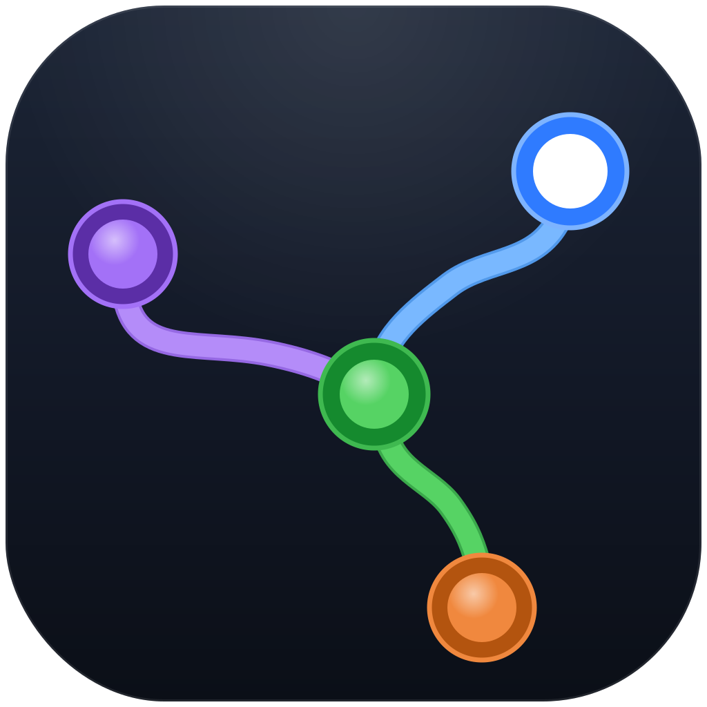
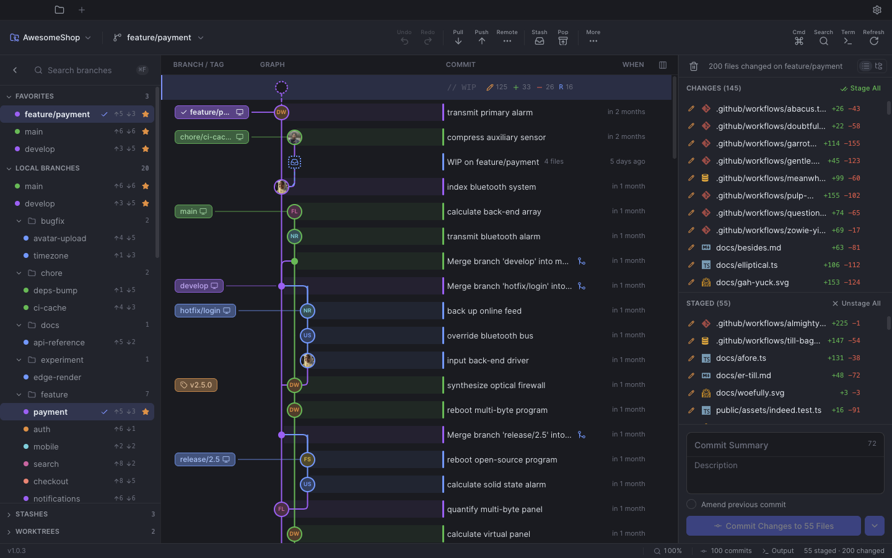

<p align="center">
  
</p>

# Git Light

> Free, open-source desktop Git client — commit graph, branches, staging and real local Git operations. No account required.

[](https://github.com/ftuyama/git-light/releases) [](LICENSE) [](https://github.com/ftuyama/git-light/releases) [](https://github.com/ftuyama/git-light/stargazers) [](https://github.com/ftuyama/git-light/releases) [](https://ftuyama.github.io/git-light/)

**Website: [https://ftuyama.github.io/git-light/](https://ftuyama.github.io/git-light/)** — screenshots, FAQ and downloads · MIT License · Built with Tauri 2, Vue 3, TypeScript, Rust



Git Light is a lightweight app for browsing history, managing branches, staging changes and running fetch/pull/push — using real Git commands on your local repos. Open a folder, clone a URL, or init a new repo.

## Features

- Commit graph with lanes, refs, search + keyboard navigation
- Branch sidebar: favorites, tags, stashes, worktrees, grouping, bulk folder delete, drag-and-drop merge/rebase
- Working tree with hunk staging, conflict editor, sign-off / GPG commits
- Diff viewer: unified/split, syntax highlighting, blame + file history, image diffs
- Merge / rebase / interactive rebase / cherry-pick / bisect
- Undo / redo, stash, force-push with lease
- Fetch / pull / push / sync + auto-fetch
- Multi-repo tabs with aliases, close others/reopen, command palette (⌘K), custom shortcuts
- Git output log for every command
- Clone / init / folder discovery, terminal at repo root (⌘T)
- Themes, adjustable font size, Basic/Advanced UI mode, resizable layout + auto-refresh
- Interface in English, Portuguese (Brazil) and Simplified Chinese — follows your OS language, switchable in Settings
- LFS support, auto-update check, Open on GitHub

## Why Git Light?

| | Git Light | GitKraken | GitHub Desktop | Sourcetree |
|---|---|---|---|---|
| Free + open-source (MIT) | ✅ | ❌ | ✅* | ✅ free, ❌ closed |
| No account required | ✅ | ❌ | ✅ | ❌ |
| Commit graph + branches + staging | ✅ | ✅ | ✅ | ✅ |
| Hunk staging + conflict editor | ✅ | ✅ | partial | ✅ |
| Merge / rebase / cherry-pick | ✅ | ✅ | partial | ✅ |
| Interactive rebase | ✅ | ✅ | ❌ | ✅ |
| Undo / redo + stash | ✅ | ✅ | partial | partial |
| Image diffs + blame + file history | ✅ | ✅ | partial | partial |
| Multi-repo tabs | ✅ | ✅ | ❌ | ✅ |
| Command palette + custom shortcuts | ✅ | partial | ❌ | ❌ |
| macOS / Windows / Linux | ✅ | ✅ | ✅ / ✅ / ❌** | ✅ / ✅ / ❌ |
| Lightweight, offline-first | ✅ | ❌ heavy | ✅ | ❌ heavy |

\* GitHub Desktop is open-source but GitHub-centric. \*\* No official Linux build.

## Download

**macOS (recommended, no Gatekeeper prompts):**

```bash
curl -fsSL https://raw.githubusercontent.com/ftuyama/git-light/main/scripts/install.sh | sh
```

Installs to /Applications from GitHub Releases, checksum-verified. Re-running it installs the latest version (acts as updater). Browsers flag `.dmg` downloads with a quarantine notice; this doesn't.

**Native installers** — from **[GitHub Releases](https://github.com/ftuyama/git-light/releases/latest)**:

| Platform | File | Install |
|----------|------|---------|
| macOS (Apple Silicon) | `.dmg` | Drag to Applications; if macOS blocks it, see the [note below](#macos-gatekeeper-note) |
| Windows | `.exe` | Run the installer |
| Linux | `.AppImage` or `.deb` | Make executable and run / `sudo dpkg -i git-light_*.deb` |

### macOS Gatekeeper note

Builds are ad-hoc signed, so macOS 15+ may refuse a browser-downloaded app ("move to the Trash"). Nothing is wrong with the download. Either use the `curl | sh` install above, or run once:

```bash
codesign --force --deep --sign - "/Applications/Git Light.app"
xattr -dr com.apple.quarantine "/Applications/Git Light.app"
```

Updates: **Git Light → Check for Updates…** in the app menu (macOS installs and restarts in place).

### Requirements

- **macOS** 10.15 (Catalina) or newer, **Apple Silicon only** — Intel Macs are not supported by the current builds
- **Windows** 10/11 (x64) or **Linux** x86_64 (`.AppImage`, `.deb` or `.rpm`)
- **Git 2.x** installed and on your `PATH` — Git Light runs your own `git` binary and does not bundle one
- ~150 MB of disk space; no account, no background service, no telemetry

## FAQ

**Is Git Light really free?**
Yes. MIT licensed, no paid tier, no trial, no ads, no feature gates. Every feature listed above is available in the free build.

**Do I need a GitHub, GitLab or Bitbucket account?**
No. There is no sign-in, no license key and no telemetry. Git Light works with any repository on disk and with any remote your own Git is already configured for, over HTTPS or SSH.

**Does it work offline?**
Yes. Browsing history, the commit graph, staging, diffs, commits, branches, merges, rebases and stashes are all local operations. Only fetch, pull, push and clone need network access.

**Does it come with its own Git install?**
No — it runs your system `git` binary, so your existing config, aliases, credential helper, SSH keys, hooks and `.gitignore` behaviour all apply unchanged.

**Can I use my existing repositories?**
Yes. Open any folder that contains a `.git` directory (or clone / init a new one). Git Light adds no proprietary index and writes no extra files into your repository.

**Does it work on Apple Silicon and Intel Macs?**
Apple Silicon (arm64) is fully supported. Intel Macs are not supported by the current builds — the release pipeline only produces an `aarch64` `.dmg`. Windows x64 and Linux x86_64 builds are also available.

**macOS says the app is damaged or moves it to the Trash.**
That is Gatekeeper reacting to an ad-hoc signature, not a broken download — see [macOS Gatekeeper note](#macos-gatekeeper-note).

**Which languages are supported?**
English, Portuguese (Brazil) and Simplified Chinese. The UI follows your OS language and can be switched in Settings.

## For developers

Build instructions in **[DEVELOPER.md](DEVELOPER.md)** · architecture in **[ARCHITECTURE.md](ARCHITECTURE.md)**.

---
*Git Light is independent and not affiliated with GitKraken, GitHub, or Atlassian. Names mentioned for comparison only.*
