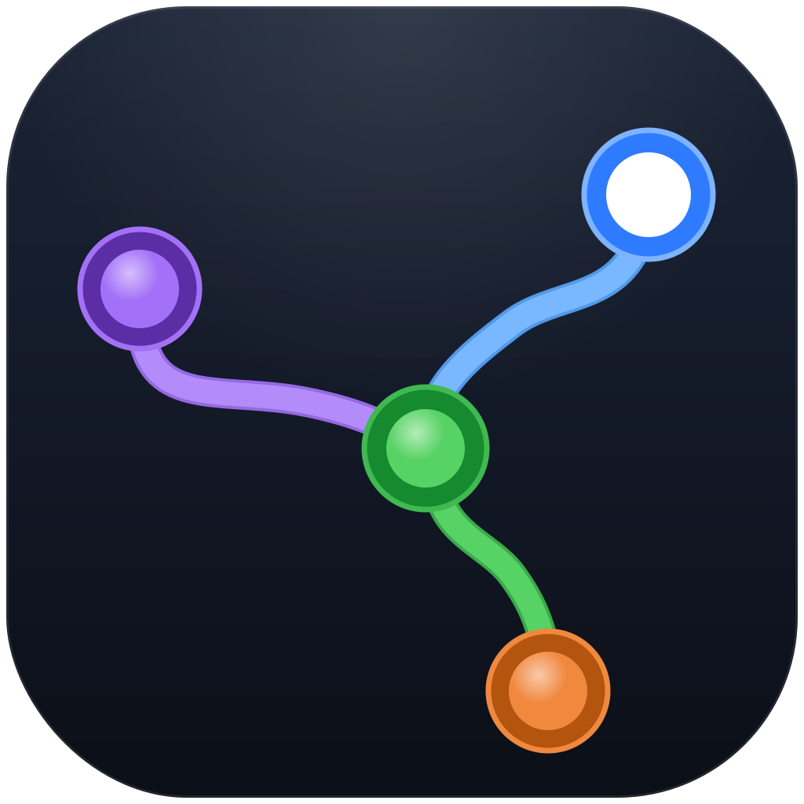
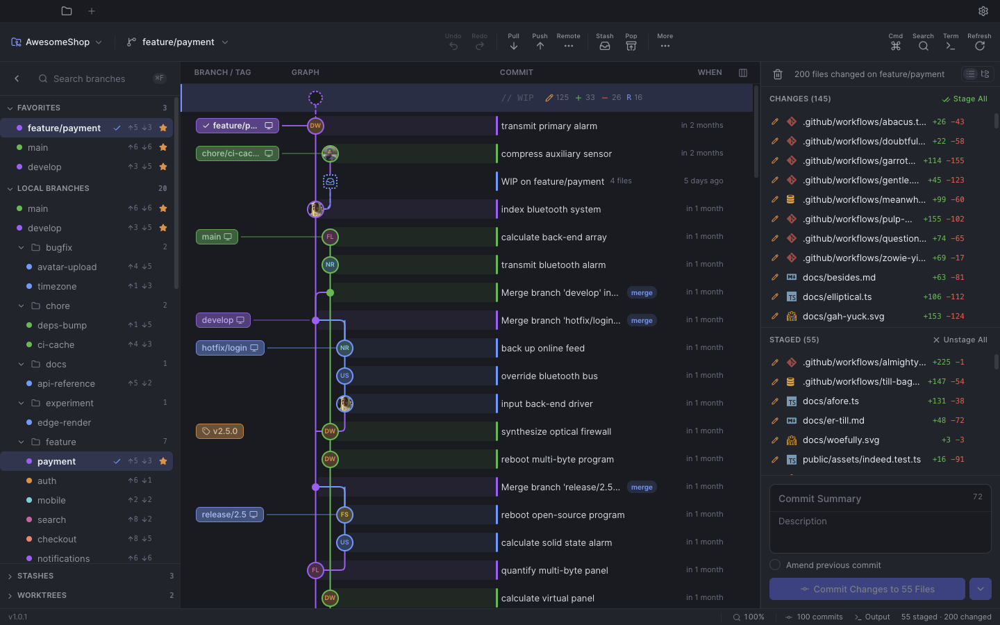

  

# Git Light

> Free, open-source desktop Git client — a lightweight **alternative to GitKraken**, GitHub Desktop and Sourcetree. Commit graph, branches, staging, merge/rebase and real local Git operations. No account required.

    

**[ftuyama.github.io/git-light](https://ftuyama.github.io/git-light/)** · MIT License · Built with Tauri 2, Vue 3, TypeScript, Rust

## What is this?

Git Light is a Tauri 2 app with a three-pane repository view that runs **real Git commands** against local repositories via typed Tauri commands. Open a folder, clone from a URL, or start a repo with init — then browse history, manage branches, stage files, commit, fetch/pull/push, and inspect diffs.

## Why Git Light?

Looking for a free, open-source **GitKraken alternative**? Git Light focuses on a fast commit graph and local-first Git — no account, no subscription, no vendor lock-in.

| | Git Light | GitKraken | GitHub Desktop | Sourcetree |
|---|---|---|---|---|
| Free + open-source (MIT) | ✅ | ❌ | ✅* | ✅ free, ❌ closed |
| No account required | ✅ | ❌ | ✅ | ✅ |
| Commit graph + branch sidebar + working tree | ✅ | ✅ | partial | ✅ |
| Real local `git` CLI backend | ✅ | ✅ | ✅ | ✅ |
| macOS / Windows / Linux | ✅ | ✅ | ✅ / ✅ / ❌** | ✅ / ✅ / ❌ |
| Lightweight, offline-first | ✅ | ❌ heavy | ✅ | ❌ heavy |

\* GitHub Desktop is open-source but GitHub-centric. \*\* No official Linux build.

## Features

| Area | Status |
|------|--------|
| Real Git backend (`git` CLI in main process; renderer never shells out) | ✅ |
| Open local repos · recent repos · multi-repo tabs · startup screen | ✅ |
| Commit graph — lanes, refs, pagination, shift-compare, keyboard nav | ✅ |
| Branch sidebar — favorites, tags, stashes, worktrees (add/remove); drag-and-drop merge/rebase | ✅ |
| Working tree — flat/tree view, stage/unstage (patch hunks), commit (sign-off, GPG/SSH `-S`) | ✅ |
| Diff viewer — unified/split, syntax highlighting, per-hunk staging, blame overlay with file history, word wrap | ✅ |
| Fetch / pull / push / sync · remote maintenance (fetch all, prune, push tags) | ✅ |
| Merge (default, ff-only, no-ff, squash) / rebase / interactive rebase / cherry-pick (continue/abort banner) | ✅ |
| Merge conflict resolution (ours/theirs/per-block) | ✅ |
| Undo / redo (reflog-backed; discard & drop-stash are intentionally unrecoverable) · force-push via `--force-with-lease` · stash · search | ✅ |
| Command palette — fuzzy launcher for actions and branches (⌘K) | ✅ |
| Bisect — start, mark good/bad, skip, reset with progress banner | ✅ |
| Git LFS — track/untrack patterns, prune local objects | ✅ |
| Open system terminal at the repo root (⌘T toolbar action) | ✅ |
| Themes — Default, Dracula, Light, Claude, System (settings) | ✅ |
| Collapsible sidebars with expand rails · commit graph zoom | ✅ |
| UI mode — Basic (essential actions) or Advanced (full toolbar and sidebar) | ✅ |
| Open on GitHub · app preferences (appearance, layout, graph, sidebar, credits) | ✅ |
| Credits & attribution (settings panel + native About dialog) | ✅ |
| Resizable three-pane layout · file watcher auto-refresh | ✅ |
| Auto-update check (packaged builds) · **Check for Updates…** menu | ✅ |
| Clone (URL + destination, SSH/credential-manager auth, progress + cancel) · Init new repository · folder discovery (subfolder resolves to root, parent scan lists nested repos) | ✅ |
| Hosting auth UI (OAuth sign-in, private-host browsing) | ❌ Not planned |

## Quick start

Download the latest installer for your platform from **[GitHub Releases](https://github.com/ftuyama/git-light/releases)**:

| Platform | Installer |
|----------|-----------|
| macOS | `.dmg` |
| Windows | `.exe` (NSIS) |
| Linux | `.AppImage` or `.deb` |

### macOS

1. Open the DMG and drag **Git Light** into **Applications**.
2. Launch **Git Light** from Applications. Notarized releases open normally; ad-hoc signed builds may require **Right-click → Open → Open** on first launch.

### Windows

1. Run the `.exe` installer and follow the setup wizard.
2. Launch **Git Light** from the Start menu or desktop shortcut.

### Linux

1. **AppImage:** make executable (`chmod +x Git-Light-*.AppImage`) and run it.
2. **deb:** install with your package manager (`sudo dpkg -i git-light_*.deb`).

To check for updates later, use **Git Light → Check for Updates…** in the menu bar (macOS) or the application menu (Windows/Linux).

## Sponsor

If Git Light is useful to you, consider supporting ongoing development:

**[Sponsor on Ko-fi](https://ko-fi.com/lelouchiee)**

## For developers

See **[DEVELOPER.md](DEVELOPER.md)** for build instructions, scripts, and local development setup. Architecture, stack, and extension points are in **[ARCHITECTURE.md](ARCHITECTURE.md)**.

## Keywords

`git-client` `git-gui` `gitkraken-alternative` `github-desktop-alternative` `sourcetree-alternative` `commit-graph` `tauri` `vue3` `typescript` `rust` `desktop-app` `developer-tools` `version-control` `macos` `windows` `linux`

## Trademark notice

Git Light is an independent open-source project, not affiliated with GitKraken, GitHub, or Atlassian. GitKraken, GitHub Desktop, and Sourcetree are trademarks of their respective owners, mentioned here for comparison only.
